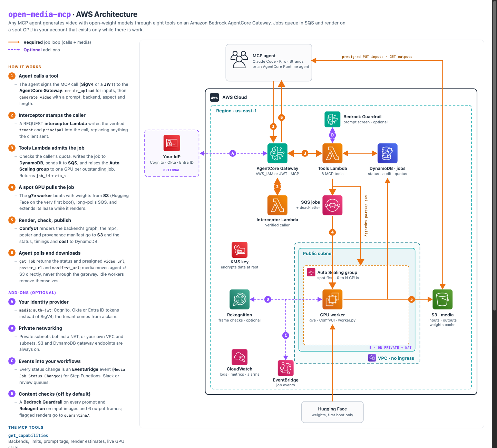

# open-media-mcp

Open-weight video **and audio** generation as **MCP tools on Amazon Bedrock AgentCore Gateway**, rendered on a
**scale-to-zero spot GPU** in your own AWS account.

Any MCP agent (Claude Code, Kiro, Strands, LangGraph, your own) calls `generate_video` or `generate_audio`, gets a `job_id` back in
under a second, and polls `get_job` for a presigned mp4, a poster frame and a provenance manifest. One
`cdk deploy` builds everything, including the Gateway. Nothing listens on the internet, and no GPU bills while
the queue is empty.



> Interactive source: [`docs/architecture.html`](docs/architecture.html). Solid orange = the required job loop;
> dashed purple = optional add-ons.

## Models

| Backend | What it makes | License |
|---|---|---|
| `wan2.2` **(default)** | Wan 2.2 A14B: text-to-video and first-frame (optionally first+last frame) to video, 720p, 16 fps, 2-8 s, silent. A soundtrack can be muxed on. | Apache-2.0 |
| `h3` (opt-in: **you need a MiniMax license in the US, EU, UK and Korea**) | MiniMax-H3 / Singularity v1.3: picture **and** stereo sound in one pass, up to 9 reference images, reference video and audio, keyframes on the timeline, lip-sync to a real song or VO, 768p, 24 fps, 5-15 s. | MiniMax H3 Community License: **not licensed in the US, EU, UK or Republic of Korea** without MiniMax's written license. Read [THIRD_PARTY_MODELS.md](THIRD_PARTY_MODELS.md). |
| `stable-audio-3` (opt-in: **free under USD 1M annual revenue**) | Stable Audio 3 (Stability AI): stereo music, instruments, sound effects and one-shots from text, 1 s to about 6 min, as WAV + MP3. Medium, small-music and small-sfx checkpoints. | Stability AI Community License: free incl. commercial use under USD 1M annual revenue (register with Stability AI); above that, a Stability enterprise license. Show "Powered by Stability AI". |
| `qwen-image` (opt-in) | Qwen-Image (Qwen team, Alibaba), 20B: text-to-image PNG, about 1.6 MP at 16:9, 9:16, 1:1, 4:3 or 3:4, 1-4 per job (about 30 s each on a warm GPU). Strong at photoreal scenes and at lettering in the image (English and Chinese). | Apache-2.0 |
| `h3-image` (opt-in: **you need a MiniMax license in the US, EU, UK and Korea**) | MiniMax-H3-Image, 33B: text-to-image and editing in one model, about 16 MP PNG at any aspect (1:1 4096x4096, 16:9 5472x3072, 4:5 3648x4576) or 4 MP drafts, up to 16 reference images (`<Picture 1>` is the image to edit), 6 steps with no CFG, 1-4 per job. A short prompt is expanded into the detailed caption the model expects (MiniMax-H3-Image-PE's instructions on Bedrock). | MiniMax-H3-Image Community License: **not licensed in the US, EU, UK or Republic of Korea** without MiniMax's written license; also needed above USD 1M revenue or to host it for others. Read [THIRD_PARTY_MODELS.md](THIRD_PARTY_MODELS.md). |

Adding a model is one Python file in `worker/backends/` (weights list + ComfyUI graph) and one JSON entry of
limits. See [Adding a backend](THIRD_PARTY_MODELS.md#adding-a-backend).

## What enterprises get

| Need | How the stack handles it |
|---|---|
| **No public endpoint** | AgentCore Gateway with `AWS_IAM` (SigV4) or `CUSTOM_JWT` (Cognito, Okta, Entra ID). There is no unauthenticated mode. GPU workers have no inbound rules; they pull from SQS. |
| **Who did what** | A Gateway REQUEST interceptor stamps the verified caller (`tenant`, `principal`) on every tool call; clients can't forge it. Jobs, uploads, quotas and `list_jobs` are tenant-scoped. Every call and job transition is logged. |
| **Content safety (opt-in)** | Off by default: straight generation, no filters. Turn on `media:guardrail=create` (an **Amazon Bedrock Guardrail** on every prompt, MEDIUM per category and tunable) or bring your company's guardrail, and/or `media:outputModeration=true` (**Amazon Rekognition** on input images and 6 sampled output frames; flagged renders go to `quarantine/` with no download URL, status `BLOCKED`). |
| **Provenance** | Each output gets a manifest: input SHA-256s, backend, model files, seed, steps, ComfyUI commit, worker instance, guardrail and moderation results, output SHA-256. The mp4 carries `ai_generated=true` metadata and the license notice where one is required. |
| **Chargeback** | Every job records its GPU seconds, the live price of the instance it ran on, and its USD cost. `cost_report` totals it per label for showback or chargeback; the fleet total shows boot and idle overhead separately. |
| **Cost control** | Spot first across GPU types and AZs (on-demand switch is one tool call), one GPU per outstanding long render up to `maxInstances` (short image and audio jobs share GPUs, since a warm one clears them faster than a new one boots), workers remove themselves after `idleMinutes` with an empty queue, per-caller daily job cap, global queue cap. |
| **Reliability** | SQS lease heartbeats while rendering; a spot interruption notice hands the job straight back; crashed jobs retry 3 times, then dead-letter (alarmed). A 2-minute reconciler guarantees queued work always has a GPU coming. Idempotency keys make agent retries safe. |
| **Data protection** | Customer managed KMS key (rotation on) for the bucket, table, queues and topic; TLS-only bucket with public access blocked; encrypted EBS; IMDSv2; lifecycle expiry for inputs (7 d), outputs (30 d) and job records (90 d). |
| **Networking** | New VPC with no inbound path by default; `privateNetworking=true` puts workers in private subnets behind a NAT; or bring your own VPC and subnets. S3 and DynamoDB gateway endpoints included. |
| **Operations** | CloudWatch dashboard (queue, jobs, render time, GPUs, tool calls), alarms for dead letters, failure bursts and a stuck queue (SNS email), EventBridge `Media Job Status Changed` events for your own workflows, Session Manager access to workers. |

## The tools

| Tool | Does |
|---|---|
| `get_capabilities` | Enabled backends with limits, prompt tag syntax, render estimates, safety settings, live GPU state. |
| `create_upload` | Presigned PUT URL (15 min) for an input image, video or audio; returns the `key` to pass to `generate_video`. |
| `generate_video` | Validate, record, enqueue a video job; returns `job_id`, `eta_s`, and whether a GPU is warm. |
| `generate_audio` | Same for audio (Stable Audio 3): prompt, seconds, model; `get_job` returns `audio_url` (WAV) and `mp3_url`. |
| `generate_image` | Same for images: Qwen-Image (prompt, negative_prompt, aspect, steps, cfg) or MiniMax-H3-Image (prompt, aspect incl. `auto`, quality `full`/`draft`, up to 16 `refs` to edit); seed, count 1-4; `get_job` returns `image_url` (PNG) and `images` (one URL and seed per image). |
| `check_identity` | Is this image the same character as the reference images (character sheet and/or approved images)? Amazon Rekognition face match in a few seconds, no GPU: `PASS`, `FAIL` or `REVIEW` with a 0-100 score. See [Character identity check](#character-identity-check). |
| `get_job` | Status (`QUEUED` → `STARTING` → `RUNNING` → `SUCCEEDED` / `FAILED` / `BLOCKED` / `CANCELLED`), phase, timings, presigned `video_url`, `poster_url`, `manifest_url`. |
| `list_jobs` | Your recent jobs, newest first, optional status filter. |
| `cancel_job` | Cancel queued or running work (a running render is interrupted on the GPU). |
| `gpu_capacity` | `status`, `warm` (skip the cold start), `release` (scale to zero), `use_on_demand` / `use_spot`. |
| `cost_report` | Chargeback: exact GPU cost per job (time on the GPU x the live spot or on-demand price), USD per second of video, grouped by backend or by any job label (`project`, `cost_center`), plus the fleet's total instance-hours including boot and idle. |

## Character identity check

Keeps a generated character on-model. Give it the character sheet (every panel counts) and/or approved images:

- `check_identity {reference: [{key}], image}` checks one image from any generator.
- `generate_video {..., identity_check: {}}` checks 8 evenly spaced frames of the finished clip against `refs` (or
  `identity_check.reference`); `get_job` returns `identity` with the verdict, the reason and per-frame scores. The job
  succeeds either way.

Rekognition compares each reference face with the largest faces in the image, after cropping and enlarging them, and
keeps the best match:

| Verdict | Rule |
|---|---|
| `PASS` | score >= 97 on a clear face |
| `FAIL` | score < 90 on a clear face (for video: any clear frame, which catches hidden cuts and face swaps) |
| `REVIEW` | 90-97, or the face is under 100 px tall or covered (sunglasses, visor, hands) |

Calibrated on 17 AI images: 9 of one character, 3 of a look-alike character, and 5 different women given the
character's hair, makeup and outfits. There were no wrong PASS or FAIL verdicts. Every look-alike scored 92.4 or
lower, and clear faces of the character scored 95.8-99.8. Small faces are why `REVIEW` exists: the real character
scored anywhere from 21 to 94 below about 100 px, so a low score there is not evidence of a different person. Tune
`pass_at`, `review_at` and `min_face` per call. A vision LLM judge (Claude Opus 5.5) caught every look-alike in the same
test but also rejected 6 of the 9 real images over small differences from the sheet, so it isn't used here. Cost:
about $0.01 per image, about $0.08 per checked clip.

## Deploy

Prerequisites: an AWS account with **spot or on-demand G-instance quota** (`g7e.4xlarge` = 16 vCPUs; check
"All G and VT Spot Instance Requests" in Service Quotas), Node 18+, AWS CDK v2, Python 3.11+ for the client.
Bedrock AgentCore Gateway must be available in the region (us-east-1 and us-west-2 have both the gateway and g7e).

```bash
git clone https://github.com/tycenjmccann/open-media-mcp && cd open-media-mcp
npm ci
npx cdk bootstrap            # once per account/region
npx cdk deploy               # ~8 min; prints GatewayUrl
```

Common options (full list under [Configuration](#configuration)):

```bash
npx cdk deploy -c media:maxInstances=3 -c media:idleMinutes=30          # fan out to 3 GPUs, stay warm longer
npx cdk deploy -c media:auth=jwt \
  -c media:jwtDiscoveryUrl=https://cognito-idp.us-east-1.amazonaws.com/<pool>/.well-known/openid-configuration \
  -c media:jwtAllowedClients=<app-client-id>                            # your IdP instead of SigV4
npx cdk deploy -c media:privateNetworking=true                          # private subnets + NAT
npx cdk deploy -c media:guardrail=create -c media:outputModeration=true    # turn on prompt + frame checks
npx cdk deploy -c media:guardrail=<guardrail-id>:<version>              # or your company guardrail
npx cdk deploy -c media:alarmEmail=oncall@example.com
npx cdk deploy -c media:backends=wan2.2,h3        # add MiniMax-H3: license required in the US, EU, UK, KR (THIRD_PARTY_MODELS.md)
npx cdk deploy -c media:backends=wan2.2,stable-audio-3   # add Stable Audio 3: free under USD 1M revenue
```

First boot downloads the weights from Hugging Face (Wan 2.2 is about 70 GB) and caches them in the stack's bucket,
so every later boot, including spot replacements, comes from S3 in a few minutes.

## Configuration

Every setting is a CDK context key. Pass one-offs with `-c media:<key>=<value>`; keep your deployment's settings in
`cdk.local.json` (gitignored, e.g. `{"media:maxInstances": 3, "media:backends": "wan2.2,h3"}`). `-c` beats
`cdk.local.json`, which beats the defaults below.

| Key | Default | What it does |
|---|---|---|
| `backends` | `wan2.2` | Comma list: `wan2.2`, `h3`, `stable-audio-3`, `qwen-image`, `h3-image` (see [THIRD_PARTY_MODELS.md](THIRD_PARTY_MODELS.md)) |
| `auth` | `iam` | `iam` (SigV4) or `jwt` with `jwtDiscoveryUrl` + `jwtAllowedClients` / `jwtAllowedAudience`; `tenantClaim` (default `sub`) |
| `instanceTypes` | `g7e.4xlarge,g7e.2xlarge,g6e.4xlarge` | GPU types in priority order |
| `maxInstances` | `1` | GPUs that can run at once (one job each) |
| `onDemand` | `false` | `true` = on-demand instead of spot |
| `onDemandPercent` | `0` | Share of on-demand above zero, e.g. `60`, when spot quota or capacity caps the fleet |
| `idleMinutes` | `20` | A worker removes itself after this long with an empty queue |
| `privateNetworking` / `vpcId` + `subnetIds` | off | Private subnets + NAT, or your own VPC |
| `guardrail` | `none` | `create` = Bedrock Guardrail on prompts (`guardrailSexual`, `guardrailHate`, `guardrailViolence`, `guardrailInsults`, `guardrailMisconduct`, each default `MEDIUM`), or `<id>:<version>` |
| `outputModeration` | `false` | `true` = Rekognition on input images and 6 output frames (`moderationMinConfidence` 80, `blockedLabels`) |
| `kms` | `true` | Customer managed key for bucket, table, queues, topic |
| `retainData` | `true` | Keep bucket, table and key on `cdk destroy` |
| `inputRetentionDays` / `outputRetentionDays` / `jobRetentionDays` | `7` / `30` / `90` | Lifecycle expiry |
| `presignTtlSec` | `3600` | Download URL lifetime |
| `dailyJobLimitPerCaller` / `maxQueuedJobs` | `100` / `50` | Per-caller daily cap (0 = off), global queue cap |
| `modelCacheBucket` | (none) | Another bucket with `models/<subdir>/<file>` weights to read before Hugging Face |
| `hfTokenSecretName` | (none) | Secrets Manager secret holding a Hugging Face token, for gated weights |
| `comfyuiRef` | a tested commit | ComfyUI branch, tag or commit sha to run (the default is the commit this release was verified on) |
| `promptModel` | `us.anthropic.claude-sonnet-5-5` | Bedrock model for the `enhance_prompt` recipe knob (prompt rewrite before render) |
| `h3GuideRef` | a pinned commit | MiniMax-AI/MiniMax-H3 commit to fetch the H3 prompt-writing guides from |
| `h3ImagePeRef` | a pinned revision | MiniMaxAI/MiniMax-H3-Image-PE revision to fetch the h3-image expansion instructions from |
| `alarmEmail` | (none) | SNS email for the dead-letter, failure and stuck-queue alarms |

## Connect an agent

**Claude Code / any stdio MCP client** through AWS's SigV4 proxy:

```json
{
  "mcpServers": {
    "open-media": {
      "command": "uvx",
      "args": ["mcp-proxy-for-aws@latest", "<GatewayUrl>", "--service", "bedrock-agentcore", "--region", "us-east-1"]
    }
  }
}
```

**Python** (the repo's client, also the smoke test):

```bash
pip install "mcp>=1.9" httpx botocore
export GATEWAY_URL=<GatewayUrl>
python examples/mcp_client.py tools
python examples/mcp_client.py generate --prompt "A lighthouse keeper climbs a spiral stair at dusk, lantern swinging" --out clip.mp4
python examples/mcp_client.py generate --first-frame still.png --prompt "She turns to camera and smiles" --aspect 9:16 --out c2.mp4
```

An agent running in **AgentCore Runtime** already has an execution role: grant it
`bedrock-agentcore:InvokeGateway` on the gateway ARN and sign with its ambient credentials.

## Speed and cost

Measured on one `g7e.4xlarge` (RTX PRO 6000 Blackwell, 96 GB), 5 s clips:

| Backend | Quality | Render |
|---|---|---|
| `wan2.2` 720p | `draft4` (lightx2v 4-step LoRAs) | **79 s** |
| `wan2.2` 720p | `full` (20 steps, cfg 3.5) | **669 s** (about 11 min) |
| `h3` 768p, with audio | `full` (20 steps) | **180 s** (a 15 s clip: about 19.5 min) |
| `h3` 768p | `draft4` | about 1 min |

| `draft4`, 79 s | `full`, 669 s |
|---|---|
|  |  |

*Same prompt and seed, both rendered through the MCP (frame at 2.5 s).*

Iterate on `draft4`, then re-run the keeper on `full` with the same seed. The first ever boot (weights from
Hugging Face, about 70 GB for Wan 2.2) reached its first render in about 6 minutes; later boots load from S3.

### What a clip costs

GPU cost per 5 s clip on spot `g7e.4xlarge` (USD 1.27/hour in us-east-1 on 2026-11-02; on-demand is USD 4.00):

| Here (your account) | Render | Cost per 5 s clip |
|---|---|---|
| Wan 2.2 720p, `draft4` | 79 s | **USD 0.03** |
| Wan 2.2 720p, `full` | 669 s | **USD 0.24** |
| MiniMax-H3 768p with audio, `full` | about 3 min | **USD 0.06** |

Each warm-up adds a cold start (about USD 0.13) and the idle tail before scale-in (20 min, about USD 0.42), so
the more clips per session, the cheaper each one gets. Fixed cost while idle: the KMS key (USD 1/month) and the S3
weight cache (about USD 1.6/month for Wan 2.2).

Hosted API list prices for a 5 s clip, read from each pricing page on 2026-11-02:

| Hosted API | Tier | Per 5 s clip |
|---|---|---|
| fal, Wan 2.2 A14B (same model as `wan2.2`) | 720p | USD 0.40 |
| Replicate, Wan 2.2 A14B image-to-video | 720p | about USD 1.00 |
| fal, MiniMax H3-max | 768p | USD 0.40 |
| Google Vertex, Veo 3.1 / Fast / Lite (with audio) | 720p | USD 2.00 / 0.50 / 0.25 |
| Google, Omni Flash 1.1 | 720p | USD 0.51 |
| xAI, Grok Imagine Video 1.5 / Lite | 720p | USD 0.70 / 0.15 |
| fal, Kling 2.6 Pro (audio on) / Kling 4.0 | 720p | USD 0.70 / 0.79 |
| fal, Seedance 2.5 | 720p | USD 2.37 |
| Runway Gen-4.5 · Luma Ray3.2 | 720p | USD 0.60 · 0.30 |

**When this wins:** volume and iteration (50 drafts in one session is about USD 2 all in), data that must stay in
your account, one governed endpoint for many agents and teams. **When an API wins:** a handful of one-off clips
(a single full Wan clip with a cold start costs about USD 0.79 here vs USD 0.40 on fal), or when you need the
top closed models (Veo 3.1, Kling 4.0) for quality.

## Repo layout

```
bin/app.ts, lib/open-media-mcp-stack.ts   CDK stack (everything, incl. AgentCore Gateway + target + interceptor)
tools.json                                 MCP tool schemas (the Gateway target's inline schema)
lambda/tools/                              the 9 tools + per-backend limits (backends.json)
lambda/interceptor/                        Gateway REQUEST interceptor: verified caller identity
worker/setup.sh                            per-boot bootstrap: uv venv, torch, ComfyUI, weights, systemd
worker/worker.py                           SQS loop, media prep, ComfyUI, moderation, provenance, S3, events
worker/backends/                           wan22.py, h3.py, stableaudio3.py (add yours here)
examples/mcp_client.py                     SigV4 MCP client + end-to-end smoke test
examples/batch.py                          submit a JSON list of jobs, wait, download, write results + cost
docs/architecture.html                     the diagram above
```

## Teardown

```bash
npx cdk destroy
```

The bucket, table and KMS key are retained by default (`media:retainData`), so outputs and the weight cache
survive. Empty and delete them by hand, or deploy with `-c media:retainData=false` first.

## Status

v0.1. Both backends are tested end to end through the MCP: Wan 2.2 (44 demo clips in one 3-GPU session) and
MiniMax-H3 (5 s with a sung line, 180 s render, USD 0.065, the line transcribed back word for word). Stable Audio 3 was added on 2026-11-02. Next backends: Wan 2.2 S2V (audio-driven lip-sync, Apache-2.0), ACE-Step
(music, Apache-2.0), Qwen-Image (stills for start frames, Apache-2.0).

## License

Apache-2.0 for this code. Model weights are under their own licenses: see [THIRD_PARTY_MODELS.md](THIRD_PARTY_MODELS.md).
